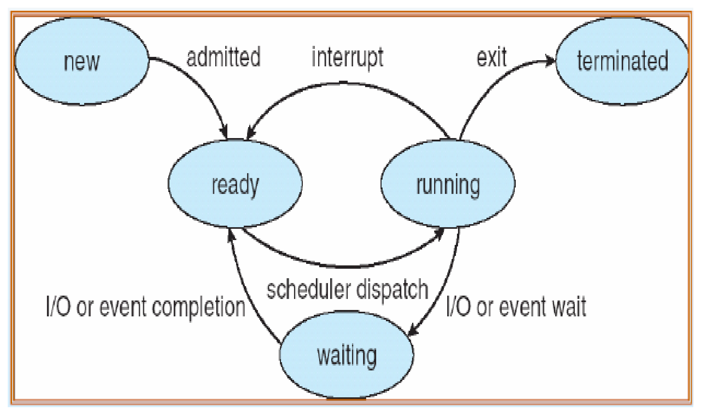
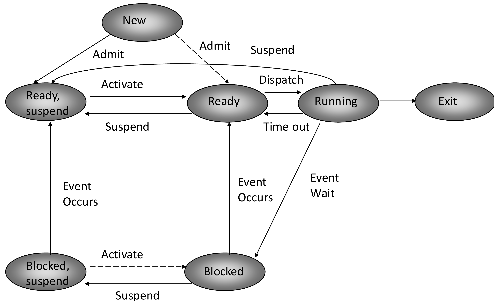
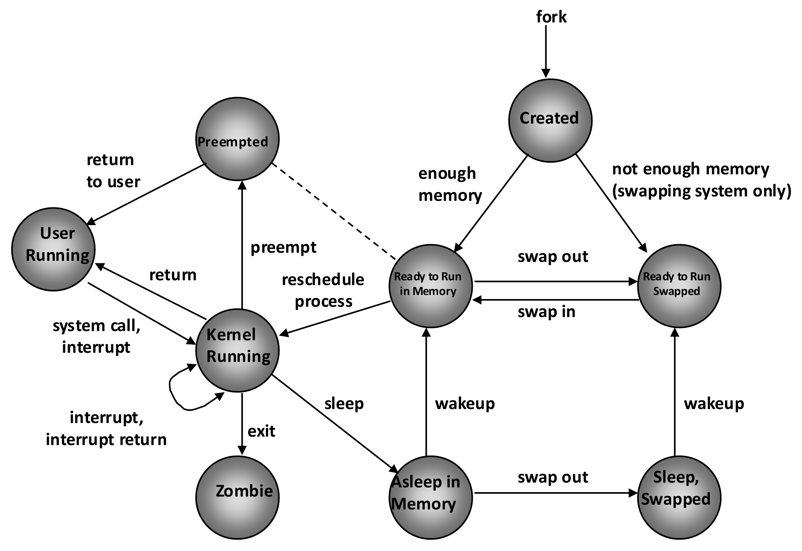

# Chương 2: Tiến trình (Process and Threads)

> Nguồn: [`ref/slides/Chapter2_Process.pdf`](../slides/Chapter2_Process.pdf) (35 slide)

---

## 1. Khái niệm tiến trình (slide 2–3, 13)

- **Tiến trình (process)** là **một chương trình đang được thực thi**. Nó gồm mã chương trình và hoạt động hiện tại của chương trình đó.
- **Chương trình** là thực thể **tĩnh**, tức file nằm trên đĩa. **Tiến trình** là thực thể **động**, đang chạy trong RAM.
- Một chương trình có thể chạy thành **nhiều tiến trình** cùng lúc, ví dụ mở 3 cửa sổ terminal.
- Mỗi tiến trình có **trạng thái riêng**: giá trị các thanh ghi và vùng nhớ riêng.
- Một tiến trình có thể gồm **nhiều luồng (thread)** thực thi đồng thời, tùy theo OS.

### Cấu trúc bộ nhớ của tiến trình

```
 Địa chỉ cao ┌──────────────┐
             │    Stack     │  biến cục bộ, tham số hàm, địa chỉ trả về (mọc xuống ↓)
             │      ↓       │
             │              │
             │      ↑       │
             │    Heap      │  cấp phát động: malloc(), new (mọc lên ↑)
             ├──────────────┤
             │    Data      │  biến toàn cục, biến static
             ├──────────────┤
 Địa chỉ thấp│    Text      │  mã lệnh (code)
             └──────────────┘
```

- **Text section:** mã chương trình. Hoạt động hiện tại được thể hiện qua **Program Counter (PC)** và các thanh ghi.
- **Stack:** dữ liệu tạm thời.
- **Data section:** biến toàn cục.
- **Heap:** vùng nhớ cấp phát động lúc chạy.

---

## 2. Trạng thái tiến trình: mô hình 5 trạng thái (slide 4–5)

| Trạng thái                | Ý nghĩa                                     |
| --------------------------- | --------------------------------------------- |
| **New**               | Đang được tạo                            |
| **Ready**             | Sẵn sàng, chờ được cấp CPU             |
| **Running**           | Lệnh đang được thực thi trên CPU       |
| **Waiting (Blocked)** | Chờ một sự kiện xảy ra, ví dụ I/O xong |
| **Terminated (Exit)** | Đã kết thúc                               |



**Cần nhớ:**

- Tại một thời điểm, **mỗi CPU chỉ có 1 tiến trình Running**. Có thể có nhiều tiến trình Ready hoặc Waiting.
- **Waiting → Running trực tiếp là không có.** Tiến trình phải quay về Ready rồi chờ được dispatch.
- **Ready → Waiting cũng không có.** Chỉ tiến trình đang chạy mới phát sinh yêu cầu I/O.

---

## 3. Process Control Block (PCB) (slide 7–12)

Mỗi tiến trình được OS biểu diễn bằng một **PCB**. PCB là "hồ sơ" chứa mọi thông tin OS cần để quản lý tiến trình:

| Thành phần                       | Nội dung                                                                        |
| ---------------------------------- | -------------------------------------------------------------------------------- |
| **Process identifier (PID)** | Số định danh duy nhất, có thể là chỉ số trong bảng tiến trình chính |
| **Process state**            | New / Ready / Running / Waiting / ...                                            |
| **Program counter**          | Địa chỉ lệnh tiếp theo sẽ thực thi                                        |
| **CPU registers**            | Giá trị các thanh ghi (lưu lại khi chuyển ngữ cảnh)                      |
| **CPU scheduling info**      | Độ ưu tiên, con trỏ tới hàng đợi lập lịch...                          |
| **Memory-management info**   | Bảng trang, bảng đoạn, thanh ghi base/limit                                  |
| **Accounting info**          | Thời gian CPU đã dùng, giới hạn thời gian...                              |
| **I/O status info**          | Danh sách thiết bị I/O và file đang mở                                     |

### Các bảng OS dùng để quản lý tài nguyên

- **Memory tables:** ghi việc cấp phát bộ nhớ chính và bộ nhớ phụ cho tiến trình, thuộc tính bảo vệ vùng nhớ dùng chung, thông tin quản lý bộ nhớ ảo.
- **I/O tables:** ghi thiết bị đang rảnh hay đã cấp cho ai, trạng thái thao tác I/O, vùng RAM làm nguồn hoặc đích của việc truyền I/O.
- **File tables:** ghi file có tồn tại không, vị trí trên bộ nhớ phụ, trạng thái hiện tại, thuộc tính. Tham khảo thêm `struct stat` và `stat()` trong C.

---

## 4. Mô hình 7 trạng thái có Suspend (slide 15)

### Vì sao cần Suspend?

- CPU chỉ chạy được tiến trình **nằm trong RAM**.
- I/O chậm hơn CPU rất nhiều, nên có lúc **mọi tiến trình trong RAM đều Blocked**. Khi đó CPU ngồi không, và RAM đầy nên không nạp được tiến trình mới.
- Giải pháp là **swapping**: đẩy một số tiến trình từ RAM ra **đĩa** để lấy chỗ cho tiến trình có thể chạy.
- **Mục đích cuối cùng là tận dụng CPU.** Swap giữa RAM và đĩa chỉ là phương tiện.

### Hai câu hỏi độc lập

|                                | Ở RAM  | Ở đĩa (suspend) |
| ------------------------------ | ------- | ------------------ |
| **Sẵn sàng chạy**     | Ready   | Ready, suspend     |
| **Đang chờ sự kiện** | Blocked | Blocked, suspend   |

Thêm New, Running và Exit là thành **7 trạng thái**.

> ⚠️ **Suspend = không nằm trong RAM**, KHÔNG có nghĩa là "đang chờ".
> **Blocked** trả lời câu hỏi "có chờ sự kiện không?". **Suspend** trả lời câu hỏi "có ở RAM không?".

### Các chuyển trạng thái mới

| Chuyển                                     | Sự kiện    | Khi nào                                                                    |
| ------------------------------------------- | ------------ | --------------------------------------------------------------------------- |
| Blocked → Blocked, suspend                 | Suspend      | Phổ biến nhất khi cần giải phóng RAM                                  |
| Blocked, suspend → Ready, suspend          | Event occurs | Sự kiện đã xảy ra nhưng tiến trình vẫn ở đĩa                    |
| Ready, suspend → Ready                     | Activate     | Nạp lại vào RAM khi RAM trống                                           |
| Ready → Ready, suspend                     | Suspend      | Chỉ khi không còn tiến trình Blocked nào để đẩy ra                |
| Running → Ready, suspend                   | Suspend      | Nhường chỗ cho tiến trình ưu tiên cao hơn                           |
| New → Ready, suspend                       | Admit        | RAM không đủ chỗ cho tiến trình mới                                  |
| New → Ready*(nét đứt)*                | Admit        | RAM còn chỗ                                                               |
| Blocked, suspend → Blocked*(nét đứt)* | Activate     | Hiếm gặp: tiến trình ưu tiên cao và OS đoán sự kiện sắp xảy ra |



**Ví dụ:** P đang Running thì gọi đọc file và chuyển sang Blocked. RAM đầy nên P thành Blocked, suspend. Đọc file xong, P thành Ready, suspend. Khi RAM trống, P được Activate về Ready, rồi được Dispatch để Running, chạy xong thì sang Exit.

---

## 5. Sơ đồ trạng thái tiến trình trong UNIX (slide 16–19)

UNIX có **9 trạng thái**, chi tiết hơn mô hình 7 trạng thái:

| Trạng thái UNIX                 | Ý nghĩa                                                                                       | Tương ứng mô hình 7 trạng thái |
| --------------------------------- | ----------------------------------------------------------------------------------------------- | ------------------------------------- |
| **Created**                 | Vừa tạo bằng`fork()`, chưa sẵn sàng chạy                                               | New                                   |
| **User running**            | Đang chạy ở**user mode**                                                               | Running                               |
| **Kernel running**          | Đang chạy ở**kernel mode**                                                             | Running                               |
| **Ready to run, in memory** | Sẵn sàng, chờ kernel lập lịch                                                              | Ready                                 |
| **Preempted**               | Đang từ kernel quay về user mode thì bị kernel chiếm quyền để chạy tiến trình khác | Ready                                 |
| **Asleep in memory**        | Chờ sự kiện, vẫn ở RAM                                                                     | Blocked                               |
| **Ready to run, swapped**   | Sẵn sàng nhưng đang ở đĩa, phải swap in trước                                         | Ready, suspend                        |
| **Sleeping, swapped**       | Chờ sự kiện và đang ở đĩa                                                               | Blocked, suspend                      |
| **Zombie**                  | Đã kết thúc nhưng còn để lại bản ghi cho tiến trình cha thu thập                   | Exit                                  |

**Điểm khác biệt so với mô hình 7 trạng thái:**

- Running được tách thành **User running** và **Kernel running**. Tiến trình chuyển sang Kernel running khi gọi system call hoặc khi có ngắt.
- Tiến trình **chỉ bị preempt khi đang chuyển từ kernel mode về user mode**.
- Có trạng thái **Zombie**: tiến trình con đã exit nhưng cha chưa gọi `wait()` để thu thập trạng thái kết thúc.



---

## 6. Lập lịch tiến trình (slide 20, 23–25)

### Các hàng đợi

- **Job queue:** tất cả tiến trình trong hệ thống.
- **Ready queue:** các tiến trình **đang ở RAM** và sẵn sàng chạy. Hàng đợi này là danh sách liên kết các PCB, có con trỏ tới PCB đầu và PCB cuối.
- **Device queue:** các tiến trình chờ một thiết bị I/O cụ thể. Mỗi thiết bị có một hàng đợi riêng.

### Queueing diagram

Tiến trình được lấy từ ready queue ra để chạy trên CPU. Nó rời CPU vì một trong 4 lý do, và cuối cùng đều **quay lại ready queue**:

1. **I/O request:** vào I/O queue, chờ I/O xong.
2. **Time slice expired:** hết lượng thời gian, quay lại ready queue ngay.
3. **Fork a child:** tạo tiến trình con, chờ con chạy.
4. **Wait for an interrupt:** chờ ngắt xảy ra.

### Hai loại bộ lập lịch

|            | Long-term scheduler (job scheduler)                                        | Short-term scheduler (CPU scheduler)                                |
| ---------- | -------------------------------------------------------------------------- | ------------------------------------------------------------------- |
| Nhiệm vụ | Chọn tiến trình nào được đưa vào**ready queue**            | Chọn tiến trình nào trong ready queue được**cấp CPU** |
| Tần suất | **Rất thấp** (giây, phút)                                        | **Rất cao** (mili giây)                                     |
| Yêu cầu  | Có thể chậm                                                             | **Phải nhanh**                                               |
| Vai trò   | Điều khiển**mức độ đa chương (degree of multiprogramming)** | Quyết định ai chạy tiếp theo                                   |

---

## 7. Chuyển ngữ cảnh (Context switch) (slide 21–22, 34–35)

- **Ngữ cảnh (context)** của tiến trình là PC, các thanh ghi và các thông tin khác, được lưu trong PCB. Slide gọi bản sao trạng thái này là **activation record**.
- **Context switch:** lưu ngữ cảnh CPU của tiến trình hiện tại vào PCB của nó, rồi nạp ngữ cảnh của tiến trình mới từ PCB của tiến trình đó.

```
 P0 đang chạy ──(ngắt / system call)──► OS: lưu trạng thái vào PCB0
                                            nạp trạng thái từ PCB1 ──► P1 chạy
                                                                       ...
 P0 chạy lại ◄── OS: nạp trạng thái từ PCB0 ◄── lưu trạng thái vào PCB1 ◄──(ngắt)
```

- Context switch là **chi phí thuần (overhead)**: trong lúc chuyển, hệ thống không làm việc có ích.

### Khi nào xảy ra chuyển tiến trình?

| Nguyên nhân             | Ví dụ                                                                        |
| ------------------------- | ------------------------------------------------------------------------------ |
| **Clock interrupt** | Tiến trình dùng hết time slice                                             |
| **I/O interrupt**   | Thao tác I/O hoàn tất                                                       |
| **Memory fault**    | Địa chỉ cần truy cập nằm trong bộ nhớ ảo, phải nạp vào RAM trước |
| **Trap**            | Lỗi xảy ra, có thể khiến tiến trình chuyển sang Exit                   |
| **Supervisor call** | System call, ví dụ mở file                                                  |

---

## 8. Tạo tiến trình (slide 26–29)

- Tiến trình tạo ra tiến trình khác thì gọi là **tiến trình cha (parent)**. Tiến trình được tạo gọi là **tiến trình con (child)**. Quan hệ cha–con tạo thành **cây tiến trình (process tree)**.
- Trong UNIX, tiến trình được tạo bằng **`fork()`**.

### Luồng xử lý fork – exec – wait

```
          ┌──── parent ─────────────► wait() ──► resumes
 fork() ──┤                             ▲
          └──── child ──► exec() ──► exit()
```

| Lời gọi                  | Tác dụng                                                                                                             |
| -------------------------- | ---------------------------------------------------------------------------------------------------------------------- |
| `fork()`                 | Nhân bản tiến trình hiện tại. Trả về**0 ở con**, **PID của con ở cha**, **< 0 nếu lỗi** |
| `exec()` (vd `execlp`) | Thay toàn bộ không gian nhớ của tiến trình bằng chương trình mới                                           |
| `wait()`                 | Cha chờ con kết thúc                                                                                                |
| `exit()`                 | Kết thúc tiến trình                                                                                                |

### Ví dụ C (slide 29)

```c
int main() {
    pid_t pid;
    pid = fork();                        /* tạo tiến trình con */
    if (pid < 0) {                       /* lỗi */
        fprintf(stderr, "Fork Failed");
        exit(-1);
    } else if (pid == 0) {               /* tiến trình con */
        execlp("/bin/ls", "ls", NULL);   /* con chạy chương trình ls */
    } else {                             /* tiến trình cha */
        wait(NULL);                      /* chờ con xong */
        printf("Child Complete");
        exit(0);
    }
}
```

> Sau `fork()` có **2 tiến trình cùng chạy tiếp từ dòng ngay sau `fork()`**. Chúng chỉ khác nhau ở giá trị `pid` trả về.

---

## 9. Đa nhiệm: Co-operative và Preemptive (slide 30–33)

|                                   | Co-operative multitasking (hợp tác)                                                                                                      | Preemptive multitasking (chiếm quyền)                        |
| --------------------------------- | ------------------------------------------------------------------------------------------------------------------------------------------ | -------------------------------------------------------------- |
| Ai quyết định lúc chuyển?    | **Tiến trình** tự nhường CPU, qua lời gọi `cswitch()`                                                                       | **OS** quyết định, dùng **timer interrupt**    |
| Ai chọn tiến trình tiếp theo? | Bộ lập lịch riêng                                                                                                                      | OS                                                             |
| Nhược điểm                    | Một tiến trình lỗi (không bao giờ nhường CPU, hoặc nhường quá muộn nên lỡ input) sẽ**chặn mọi tiến trình khác** | Tốn chi phí context switch                                   |
| Mức độ                         | Cải tiến hơn co-routine: đã ẩn cơ chế chuyển ngữ cảnh                                                                           | **Mạnh nhất**, được dùng trong các OS hiện đại |

**Cơ chế preemptive:** timer gây ngắt, OS giành quyền điều khiển và lưu trạng thái tiến trình bị ngắt. OS chọn tiến trình tiếp theo rồi chuyển sang chạy nó.

```
 ── P1 ──┤int├── OS ──── P1 ──┤int├── OS ──── P2 ──►  thời gian
```

---

## ✅ Checklist tự ôn

- [ ] Phân biệt **chương trình** và **tiến trình**.
- [ ] Vẽ được sơ đồ **5 trạng thái** và giải thích từng mũi tên.
- [ ] Kể được các thành phần của **PCB**.
- [ ] Giải thích **vì sao cần Suspend**, gắn với việc tận dụng CPU.
- [ ] Phân biệt **Blocked** và **Suspend**, vẽ được mô hình **7 trạng thái**.
- [ ] Ánh xạ được trạng thái UNIX sang mô hình 7 trạng thái. Hiểu **Zombie** và **Preempted**.
- [ ] Phân biệt **job queue / ready queue / device queue**.
- [ ] So sánh **long-term** và **short-term scheduler**.
- [ ] Mô tả các bước của **context switch** và 5 nguyên nhân chuyển tiến trình.
- [ ] Đọc hiểu code `fork()`: biết giá trị trả về ở cha và ở con.
- [ ] So sánh **co-operative** và **preemptive multitasking**.
