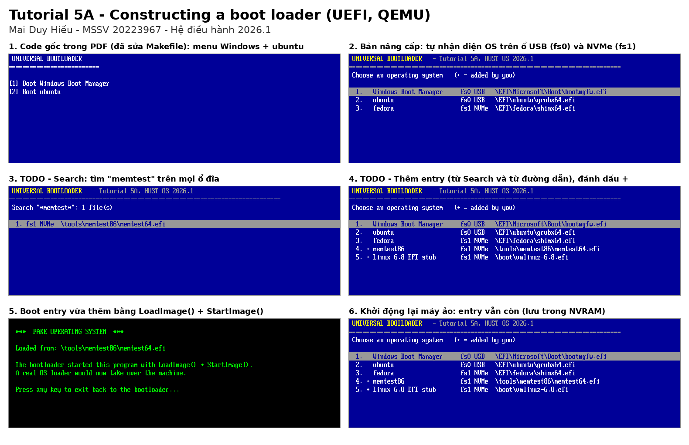

# 🛠️ Tutorial 5A: Xây dựng Boot Loader (UEFI)

---

## 🎯 1. Mục Tiêu

1. Viết một **UEFI bootloader** bằng C (thư viện gnu-efi), chạy trực tiếp trên firmware, khi chưa có hệ điều hành.
2. Bootloader quét mọi ổ đĩa (USB, NVMe, SATA...), tìm Windows/Linux và hiện menu chọn OS.
3. Chạy thử an toàn trong máy ảo **QEMU** với firmware UEFI **OVMF**.
4. **TODO (bước 5 trong PDF):** cho người dùng **tìm kiếm và thêm boot entry** vào menu.



---

## 💻 2. Môi Trường

| Thành phần | Phiên bản |
| :--- | :--- |
| Host | Ubuntu 26.04.1 LTS (x86_64) |
| Compiler | gcc 15.2.0, binutils 2.46 |
| Thư viện UEFI | `gnu-efi` 4.0.0 |
| Máy ảo | `qemu-system-x86_64` 10.2.1 + OVMF (`/usr/share/OVMF/OVMF_CODE_4M.fd`) |

---

## 📂 3. Cấu Trúc Thư Mục

```text
tutorial_5/
├── original/main.c         # Code gốc trong PDF (giữ nguyên để đối chiếu)
├── main.c                  # Bản nâng cấp: sửa lỗi + làm phần TODO
├── fake_os.c               # "OS giả" để thử boot (in ra đường dẫn rồi quay lại menu)
├── Makefile                # Build + tạo ổ đĩa ảo + chạy QEMU
├── screenshots/            # Ảnh chụp từng bước trong QEMU
└── MaiDuyHieu_20223967.png # Ảnh tổng hợp để nộp
```

---

## 🚀 4. Cách Chạy

```bash
sudo apt install build-essential gnu-efi mtools qemu-system-x86 ovmf
cd src/exercises/tutorial_5
make                              # build main.efi, original.efi, fake_os.efi
make run                          # chạy bản nâng cấp (mở cửa sổ QEMU)
make run BOOTLOADER=original.efi  # chạy code gốc trong PDF
make run-serial                   # chạy ngay trong terminal (thoát: Ctrl-A rồi X)
make reset-vars                   # xoá NVRAM (mất các entry đã thêm)
make clean
```

Máy ảo có **2 ổ đĩa** (PDF chỉ dùng 1 ổ):

| Ổ | Loại | Nội dung |
| :--- | :--- | :--- |
| `disk.img` (fs0) | **USB** | `EFI/BOOT/BOOTX64.EFI` = bootloader, Windows giả, `EFI/ubuntu/grubx64.efi` |
| `disk2.img` (fs1) | **NVMe** | `EFI/fedora/shimx64.efi`, `tools/memtest86/memtest64.efi`, `boot/vmlinuz-6.8.efi` |

Hai file `memtest64.efi` và `vmlinuz-6.8.efi` **không** được tự nhận diện, nên phải dùng chức năng Search/Add của bài TODO mới đưa được vào menu.

---

## ⚠️ 5. Makefile Trong PDF Không Chạy Trên Ubuntu 26.04

| Lỗi | Nguyên nhân | Cách sửa |
| :--- | :--- | :--- |
| `objcopy: main.so: file format not recognized` | binutils 2.46 bỏ tên target `efi-app-x86_64` | `objcopy ... -O pei-x86-64 --subsystem efi-app` |
| Bootloader chỉ hiện **màn hình xanh trống**, không có chữ | gnu-efi 4.0 để chuỗi hằng trong section riêng `.rodata`, mà lệnh `objcopy` trong PDF không chép section này | thêm `-j .rodata` |
| Gọi `CopyMem` thì treo máy | Trong `libefi.a` của Ubuntu, `CopyMem`/`SetMem` được biên dịch theo MS ABI nhưng header khai báo kiểu SysV, nên tham số bị truyền sai thanh ghi | không dùng `CopyMem`, tự viết hàm `CopyBytes` |
| Copy Makefile từ PDF báo `missing separator` | Tab bị đổi thành dấu cách khi copy | gõ lại Tab ở đầu các dòng lệnh |

---

## 🐞 6. Lỗi Trong Code Gốc (đã sửa ở `main.c`)

1. **`WaitForEvent(..., NULL)`:** tham số `Index` không được phép là `NULL` theo spec UEFI. OVMF bỏ qua lỗi này, nhưng firmware thật có thể treo.
2. **Vòng đọc thư mục `EFI` có thể lặp vô hạn:** vòng lặp chỉ dừng khi gặp `EFI_NOT_FOUND`. Nếu `Read` trả lỗi khác (ví dụ `EFI_BUFFER_TOO_SMALL`), nó chạy mãi.
3. **Tràn mảng `Entries`:** mục Windows được thêm mà không kiểm tra `EntryCount < MAX_ENTRIES`.
4. **"No OS found. Press key to refresh..." không quét lại thật**, mà chỉ hiện một menu rỗng.
5. **Chỉ chọn được mục 1–9** vì menu dùng phím số.
6. **Watchdog:** firmware bật watchdog 5 phút khi chạy một boot option. Nếu ngồi ở menu quá 5 phút, máy tự reset. Đã sửa bằng `SetWatchdogTimer(0, ...)`.
7. **Trên máy thật chỉ thấy ổ boot:** nhiều firmware bật "fast boot" nên chỉ kết nối ổ boot. Đã thêm `ConnectController` cho mọi handle để thấy hết các ổ.

---

## ✅ 7. Bài TODO: Tìm Kiếm & Thêm Boot Entry

Phím tắt ở menu chính: `↑ ↓ Enter / 1-9` boot, `S` search, `A` add path, `D` delete, `R` rescan, `Esc` thoát về firmware.

| Chức năng | Cách hoạt động |
| :--- | :--- |
| **Tự nhận diện** (mở rộng so với PDF) | Windows (`bootmgfw.efi`); mọi thư mục `\EFI\<distro>\` có `shimx64.efi`, `grubx64.efi` hoặc `systemd-bootx64.efi`; file fallback `\EFI\BOOT\BOOTX64.EFI` trên ổ khác (trừ chính bootloader). Mỗi entry hiện kèm loại ổ (USB/NVMe/SATA) lấy từ device path. |
| **S – Search** | Gõ mẫu tên file (`*`, `?`; gõ chữ thường như `grub` thì hiểu là `*grub*`). Hàm `SearchDir()` duyệt **đệ quy** mọi ổ, sâu tối đa 6 cấp thư mục, và liệt kê các file `.efi` khớp mẫu. Chọn một kết quả, đặt tên, và entry được thêm vào menu. |
| **A – Add path** | Chọn ổ, rồi gõ đường dẫn (gõ `/` hay `\` đều được). Bootloader kiểm tra file có tồn tại trước khi thêm. |
| **D – Delete** | Xoá entry do người dùng thêm (có dấu `+`). Entry tự nhận diện thì không xoá được. |
| **R – Rescan** | Kết nối lại thiết bị (ví dụ USB mới cắm) rồi quét lại. |
| **Lưu NVRAM** | Entry tự thêm được ghi vào biến UEFI `UniversalBootEntries`, nên vẫn còn sau khi khởi động lại (ảnh `11_after_reboot_nvram.png`). Mỗi entry lưu tên, đường dẫn và **device path của ổ chứa nó**, chứ không lưu số `fsN`, vì thứ tự `fsN` có thể đổi khi cắm thêm ổ. |

**Cách boot một entry:**

```c
Dp = FileDevicePath(Volumes[E->Vol].Handle, E->Path);   // device path của ổ + đường dẫn file
BS->LoadImage(FALSE, ImageHandle, Dp, NULL, 0, &NewImage);
BS->StartImage(NewImage, NULL, NULL);   // nếu chương trình kia thoát thì quay lại menu
```

---

## 🖼️ 8. Ảnh Chụp (`screenshots/`)

| File | Nội dung |
| :--- | :--- |
| `00_original_pdf_code.png` | Code gốc chạy được sau khi sửa Makefile |
| `01_countdown.png` | Đếm ngược 5 giây trước khi boot mục mặc định |
| `02_menu_auto_detect.png` | Menu: tự nhận diện Windows, ubuntu (USB) và fedora (NVMe) |
| `03`–`05` | Search "memtest", chọn kết quả, thêm vào menu |
| `06`–`07` | Add path: chọn ổ NVMe, gõ `/boot/vmlinuz-6.8.efi`, đặt tên |
| `08_menu_with_custom.png` | Menu có 2 entry tự thêm (dấu `+`) |
| `09`–`10` | Boot entry tự thêm, rồi quay lại bootloader |
| `11_after_reboot_nvram.png` | Sau khi khởi động lại, entry vẫn còn |
| `12_after_delete.png` | Đã xoá một entry |
| `13_search_all_efi.png` | Search rỗng: liệt kê mọi file `.efi`, đánh dấu file đã có trong menu |

---

## 💡 9. Lưu Ý Khi Chạy Trên Máy Thật (USB)

* **Secure Boot** sẽ chặn bootloader này (`LoadImage` trả `Security Violation`), vì file chưa được ký. Muốn chạy thì phải tắt Secure Boot trong BIOS.
* Copy `main.efi` thành `EFI/BOOT/BOOTX64.EFI` trên USB định dạng FAT32, rồi chọn boot từ USB trong boot menu của máy.
